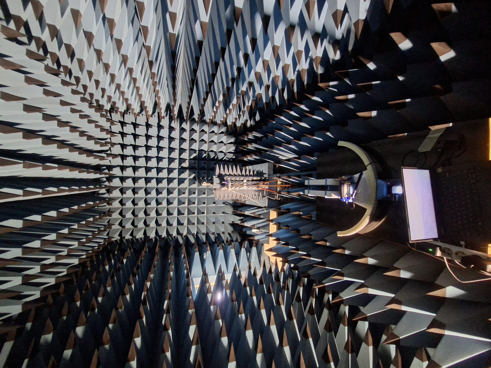
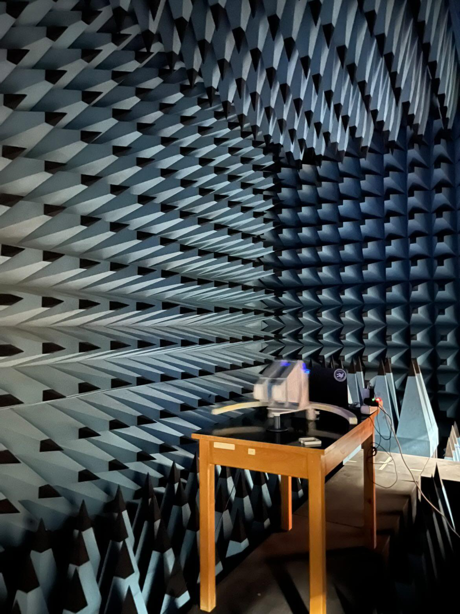
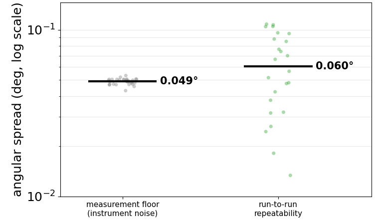
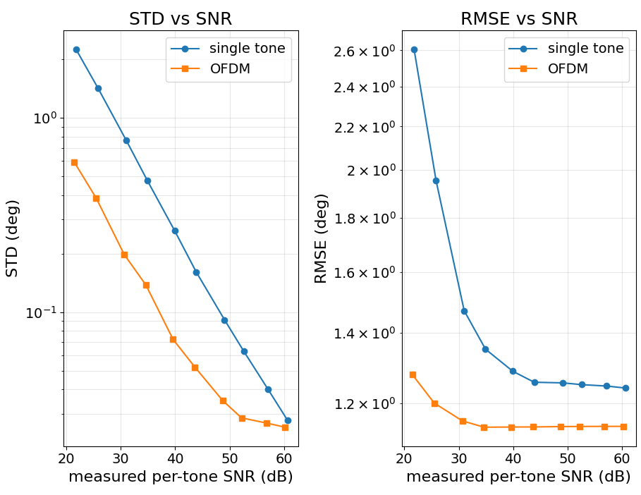

# Characterization

Measurement-based characterization of the positioning platform: the angular
repeatability of the stage itself, and a reference-application validation using an
OFDM-enhanced phase-comparison monopulse Angle-of-Arrival (AoA) estimator.

> **Status — results under review.** The results summarized here are from a
> manuscript currently under peer review. This page is a short summary for people
> browsing the repository; the paper is the primary, citable source — please cite
> it once published (see [`../../CITATION.cff`](../../CITATION.cff)). The figures
> below are the authors' own, numbers are rounded, and the full method, setup, and
> analysis are in the paper.

## Measurement setup

All measurements were taken in an **anechoic chamber**. A modified **dual-channel
ADALM-Pluto SDR** (AD9361-compatible 2×2 mode) at **2.3 GHz** feeds two
directional log-periodic antennas (λ/2 = 65 mm) as the receive payload, with a
transmit antenna positioned down-range. Mounting the receiver on the stage keeps
the transmitter–receiver geometry fixed across a sweep, so the commanded angle is
the only quantity that changes.

## Angular repeatability

The platform's own mechanical repeatability is measured by treating the
deterministic estimator as an **angular transducer**: at a fixed commanded angle
the reading is fixed, so the spread between independent returns to that angle
reflects how precisely the stage repositions, independent of estimator bias.

With `N_c = 30` captures per take, the per-mean measurement floor is
`σ_meas = σ_cap / √N_c`. The run-to-run spread between independent takes, `σ_obs`,
combines that floor with the mechanical repositioning error, so the positioner's
own contribution is isolated in quadrature as `σ_rep = √(σ_obs² − σ_meas²)`.

Over **1140 independent repositionings**, the instrument-noise floor is
**≈ 0.049°** and the stage's run-to-run repeatability is **≈ 0.060°** — on the
order of a single measurement's resolution, and within the **0.1°** budget of the
sweeps.

## Reference application — OFDM-enhanced monopulse AoA

As a representative payload, an **OFDM-enhanced phase-comparison monopulse**
estimator ([Alogdianakis et al., CSNDSP 2026](https://doi.org/10.1109/CSNDSP68462.2026.11654469)) was characterized against
a single-tone baseline. In the
maximum-diversity configuration (**16 tones at 1.2 MHz spacing**, evaluated over a
**±30°** window), the automated campaign collected **≈ 342,000 AoA estimates**
across waveform, angle, and SNR configurations — a volume impractical to collect
by hand.

Averaging the monopulse ratio across the orthogonal tones lowers the AoA standard
deviation by up to **≈ 4×** at low SNR. In RMSE, the single-tone estimator rises
to ≈ 2.6° at the lowest measured SNR and settles to a ≈ 1.25° floor, while the
OFDM estimator stays within ≈ 1.1–1.3° across the whole sweep; its accuracy at the
lowest measured SNR already matches the single-tone high-SNR floor — an effective
SNR gain **in excess of 10 dB**. Both estimators share the same high-SNR floor,
set by geometry and residual hardware bias, confirming the OFDM advantage is a
reduction of noise-driven error rather than a change in bias.

## Reproducing and citing

The firmware, host-side control software, and hardware needed to reproduce these
measurements are in the repository; see [`../../README.md`](../../README.md) for
the overview and [`../../CITATION.cff`](../../CITATION.cff) for how to cite the
platform and the associated paper.
