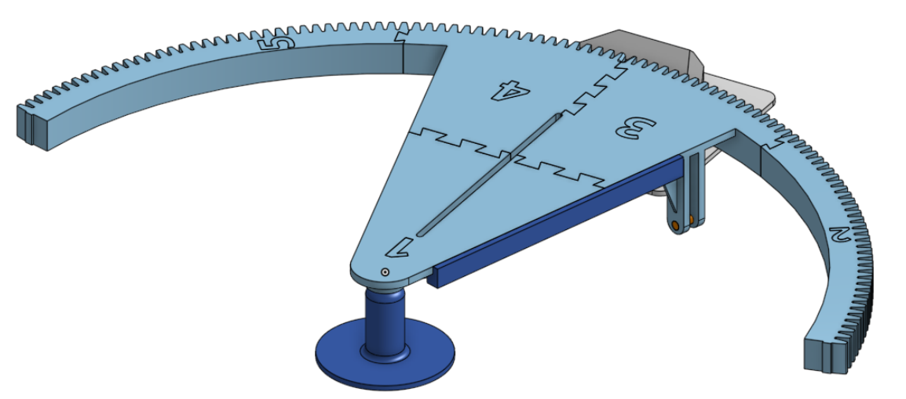
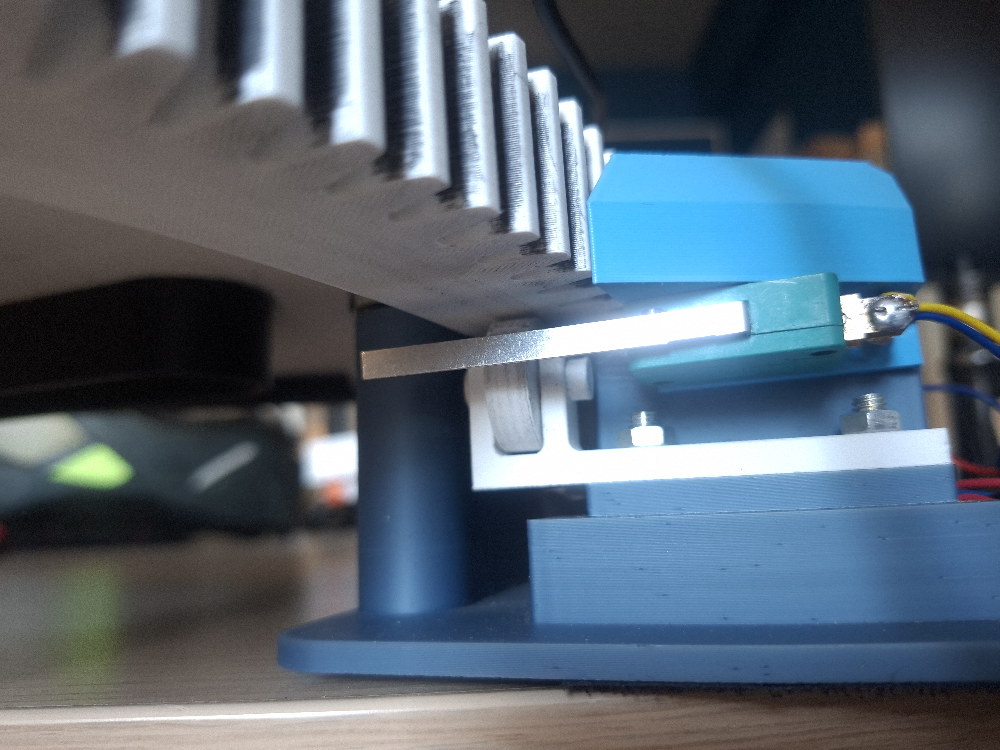
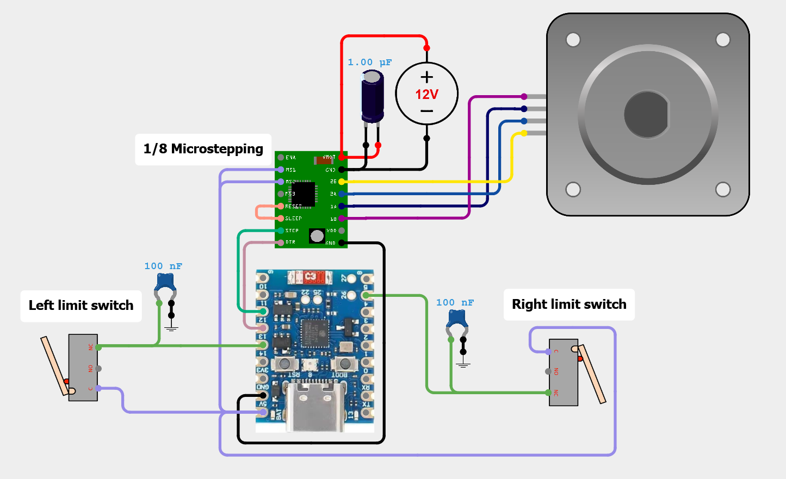
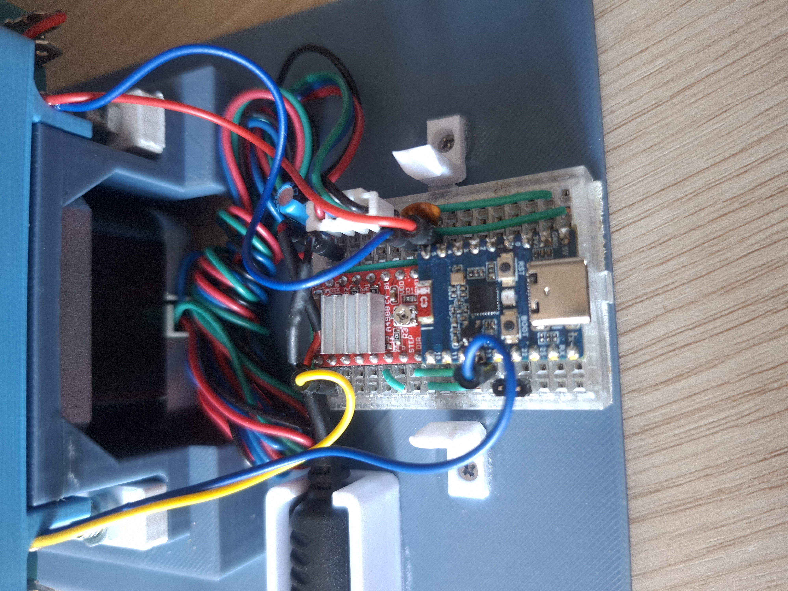
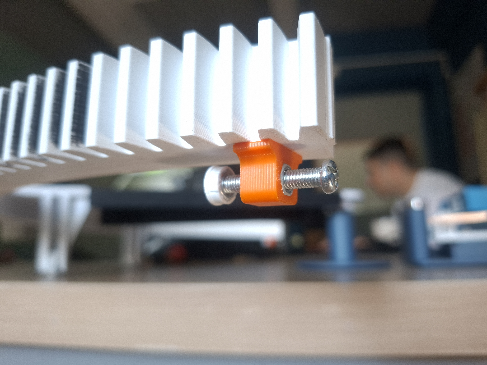

# Assembly

Build guide for the positioning base: print, mechanical assembly, limit-switch
setup, wiring, and calibration. Read the [hardware overview](../README.md) and
the [print notes](../stl/README.md) first — this guide assumes every part in
[`../stl/`](../stl/) is printed and the [BOM](../bom/bom.csv) components are on
hand.

Reference renders of the finished moving sector:
[`platform_view1`](../../docs/images/platform_view1.png) and
[`platform_view2`](../../docs/images/platform_view2.png).

## Tools and consumables

- **Cyanoacrylate (instant) glue** — dovetail joints, rigidity ribs, limit-switch
  actuators, and switch risers.
- Hex/Allen keys and a Phillips screwdriver.
- **M3** screws (motor), **M5** bolts/nuts (payload slot and limit-switch
  actuators) — see the [BOM](../bom/bom.csv).
- PTFE lubricant — only if you print `Bearing.stl` instead of using 672ZZ bearings.

## 1. Print the parts

PLA, 0.2 mm layer height, 3 perimeters, 40% infill; no single part exceeds a
25 × 25 × 25 cm build volume. See [`../stl/README.md`](../stl/README.md) for
per-part notes, the optional rigidity ribs, and the printed-bearing option.

## 2. Assemble the moving sector (numbered segments)

The moving sector — the triangular arm plus the toothed arc — prints as **five
dovetailed segments, embossed `1`–`5`**. Assemble them in ascending order,
matching the embossed numbers and the dovetails to the reference renders
([`platform_view1`](../../docs/images/platform_view1.png) /
[`platform_view2`](../../docs/images/platform_view2.png)).

| Segment | STL | Location in the sector |
|---|---|---|
| 1 | `Moving_section_1.stl` | Arm pivot tip — carries the bearing hole on the rotation axis |
| 2 | `Moving_section_2.stl` | Arc end at one travel extreme |
| 3 | `Moving_section_3.stl` | Arm body — underside hole for a bearing wheel |
| 4 | `Moving_section_4.stl` | Arm body — underside hole for a bearing wheel; the 3–4 joint sits on the centerline (boresight) |
| 5 | `Moving_section_5.stl` | Arc end at the other travel extreme |

1. Dry-fit the segments `1` → `5` along their printed dovetails on a flat
   surface, with every embossed number facing up (as in the renders).
2. Check the **arc teeth line up across each joint** — a step in the tooth line
   will bind against the pinion.
3. Bond each dovetail with cyanoacrylate, working `1` → `5` and keeping the arc
   flat so it stays planar.
4. *(Optional)* add the rigidity ribs from [`../stl/README.md`](../stl/README.md):
   `Support_rib_side.stl` glued to the side of the sector, `Support_rib_middle.stl`
   beneath the centerline slot.

> The centerline **5.15 mm slot** is the payload interface — it accepts 5 mm
> bolts/pins and slides so the payload's phase center sits on the rotation axis.

## 3. Mount the sector on the base

1. Fasten the NEMA 17 stepper to `Stationary_base-motor_section.stl` with **M3**
   screws. Press the 12-tooth pinion (`Pinion gear.stl`) onto the shaft, then fit
   `Pinion_gear_cover.stl` over it — the cover keeps cabling clear of the gear
   teeth.
2. Fit the pivot: segment 1 turns on a **672ZZ** bearing at the central axis
   (`Front_rotation_axis.stl`), so the arm rotates in place.
3. Fit the **bearing wheels**: `Moving_section_3` and `Moving_section_4` each have
   a hole in the underside — press a **672ZZ** bearing in and run a
   `BearingPin.stl` (or a metal pin) through it so the bearing rolls as a wheel on
   the base, carrying the sector at height. `Support_bracket_with_bearing.stl`
   (2 bearings + 2 bearing pins) supports the far arc. `Bearing.stl` can be
   printed in place of a 672ZZ bearing — lubricate the mating faces with PTFE if
   you do.
4. Mesh the arc teeth with the pinion and confirm the sector sweeps the full
   **±70° mechanical range freely** before calibrating.

## 4. Limit switches (on the stationary base)

1. Mount each long-lever microswitch on its printed riser on the stationary base,
   roughly where the arc reaches each extreme (≈ **±65°**) so the actuator can
   reach the lever — the exact trip point is set later with the actuator bolt
   (Step 6). Fix the switch with screws and bond the riser to the base with
   cyanoacrylate if needed.
2. Orient the lever so the actuator **sweeps into it**, rather than hitting it
   end-on.
3. The firmware reads the switches on `INPUT_PULLUP` with a RISING interrupt:
   **+65° → GPIO5**, **−65° → GPIO13** (see
   [`../../firmware/README.md`](../../firmware/README.md)). A status LED lights
   while a switch is held, which the calibration in Step 6 relies on.

## 5. Wiring

The whole circuit is built on a **mini breadboard** mounted on the stationary
base. Wire the ESP32-H2, A4988 driver, stepper, limit switches, and 12 V supply
per the wiring diagram and the firmware pin table in
[`../../firmware/README.md`](../../firmware/README.md). Each limit switch takes a
**100 nF** cap across its contacts for debouncing, and a **1 µF** cap sits across
the A4988 `VMOT`/`GND`.

The photo below is the as-built wiring. The **ESP32-H2 and A4988 plug straight
into the breadboard**, so several connections are hidden **beneath the two
boards** — the shared ground and power rails, the `STEP`/`DIR` and microstepping
(`MS1`/`MS2`) logic links between the microcontroller and the driver, and the
decoupling caps all run through the breadboard rows under the PCBs and are not
visible here. Use the wiring diagram above as the complete netlist.

## 6. Boresight and range calibration

Initial calibration is done **by hand** — it sets mechanical 0° and glues and
tunes each limit-switch actuator against its switch. It does **not** use
`AUTOCENTER`; that command is only for returning to centre *after* the switches
are calibrated.

**Parts per actuator:** `Limit_switch_actuator.stl`, `Limit_switch_actuator_cap.stl`,
one **M5 × 30 mm bolt**, **two M5 nuts**. Pre-assemble both: thread the bolt
through the actuator (one M5 nut against the body), fit the cap on the end and
lock it with the second nut, and **back the bolt out about two-thirds of its
thread** so there is room to screw it in toward the switch.

Power the base and connect at **115200 baud**, then:

1. **Set boresight (0°).** By hand, bring the moving sector to centre so the
   **3–4 segment joint lines up with the base's boresight** — this makes 0° easy
   to see. Send `HOME` to store this position as 0°.
2. **Go to the −65° extreme.** Send `GOTO -65`.
3. **Glue the −65° actuator.** Holding the sector at −65°, glue the pre-assembled
   actuator (cyanoacrylate, bolt still backed out ~2/3) to the underside edge of
   the arc at the switch.
4. **Screw in to the trip point.** Slowly screw the actuator bolt in until the
   limit switch triggers — **the status LED turns on** the instant it does.
5. **Check the margin.** Send `GOTO 0`, then `GOTO -64.9`. The **LED must stay off
   at −64.9°** (switch not yet engaged). If it lights, the trip point is too
   early — screw/unscrew the actuator bolt and repeat from step 3 until −65° trips
   and −64.9° does not.
6. **Repeat for +65°.** `GOTO 65`, then glue and tune the second actuator the same
   way, confirming the LED stays off at +64.9°.

> Once both sides are set, the firmware re-references the open-loop position on
> every limit-switch hit, and `AUTOCENTER` can be used any time to return to
> mechanical centre.
